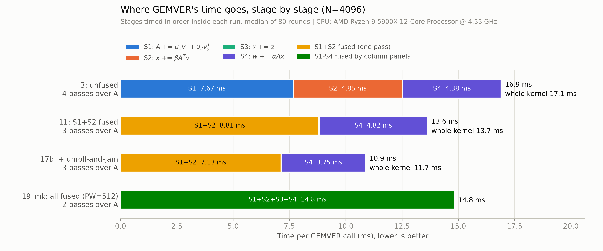
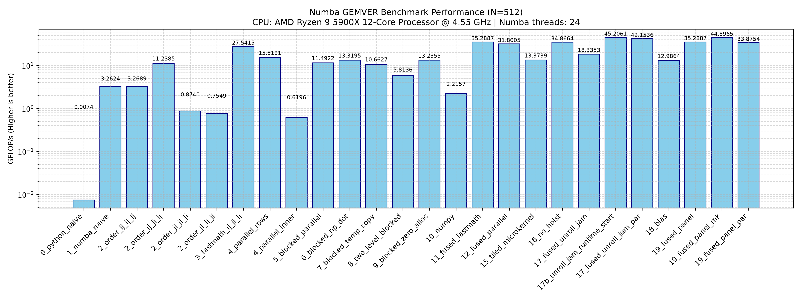
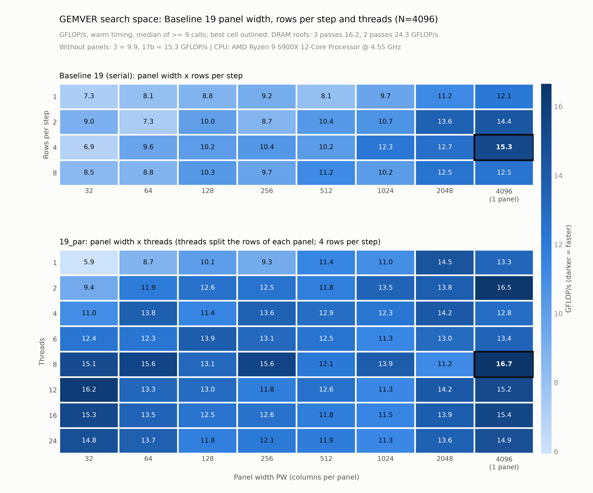
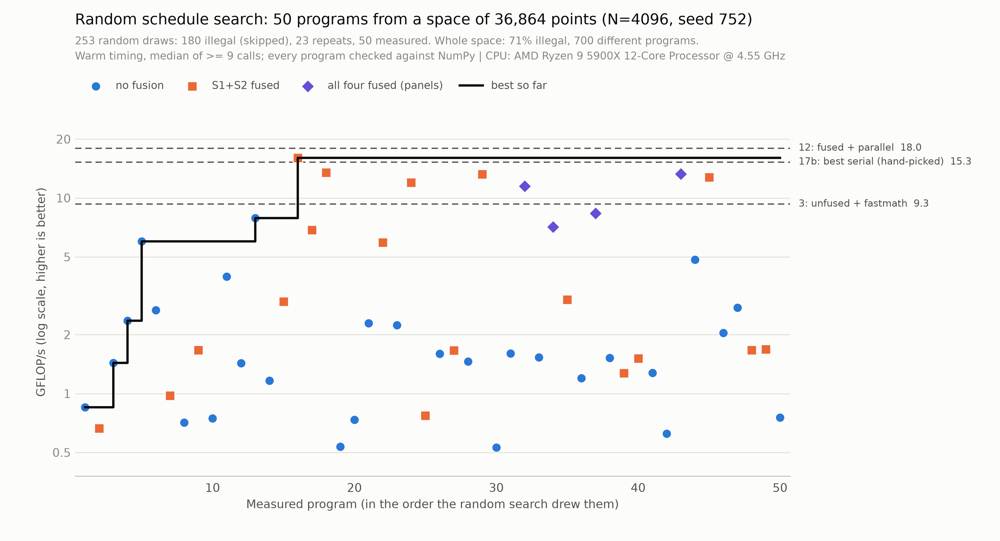

# GEMVER example

GEMVER ("vector multiplication and matrix addition") is a PolyBench linear-algebra kernel. In BLAS
terms it is two rank-1 updates (GER) followed by two matrix-vector products (GEMV). The BLAS
Technical Forum standard lists it as one fused "BLAS 2.5" routine, used for example when a matrix
is reduced to bidiagonal form on the way to its SVD. For an `N x N` matrix `A` and vectors
`u1, v1, u2, v2, w, x, y, z`, it runs four stages in order:

```
S1:  A = A + u1 v1^T + u2 v2^T      (update every element of A)
S2:  x = x + beta * A^T y           (matrix-vector product with A transposed)
S3:  x = x + z                      (vector add)
S4:  w = w + alpha * A x            (matrix-vector product)
```

The code is in `../../benchmarks/gemver_numba_bench.py`. Every version updates `A`, `x` and `w`
in place and is checked against a NumPy reference (`rtol = atol = 1e-5`).

## Code optimization

GEMVER is **memory-bound**. It does about 10 FLOPs per element of `A`, but the plain code moves
`A` through memory four times (S1 reads and writes it, S2 and S4 read it again): 32 bytes per
element, or 0.31 FLOP/byte. A core of the test machine can do about 73 GFLOP/s but stream only
about 37 GB/s, so it needs about 2 FLOP/byte to keep busy. For GEMVER at a size where `A` does not fit in
cache, a good first estimate is **time = passes over A x time per pass**. At `N = 4096`, `A` is
134 MB and one pass takes about 3.5 ms. The optimizations below either make each pass as fast as
memory allows (stride-1 access, SIMD) or remove passes (fusion).

| Stage | FLOPs | Bytes of A moved | FLOP/byte | Depends on |
| :--- | :--- | :--- | :--- | :--- |
| S1 | 4N² | 16N² (read + write) | 0.25 | nothing: every element is independent |
| S2 | 3N² | 8N² (read) | 0.375 | the new `A` from S1 |
| S3 | N | none (3 vectors) | - | all of S2 |
| S4 | 3N² | 8N² (read) | 0.375 | the **final** `x`, so all of S1-S3 |
| Total | 10N² + N | 32N² unfused | 0.31 | |

### 0- naive baseline

The direct translation of the PolyBench loops, run by the Python interpreter:

```python
def gemver_python_0(alpha, beta, A, u1, v1, u2, v2, w, x, y, z):
    n = A.shape[0]
    for i in range(n):                       # S1
        for j in range(n):
            A[i, j] = A[i, j] + u1[i] * v1[j] + u2[i] * v2[j]
    for i in range(n):                       # S2
        for j in range(n):
            x[i] = x[i] + beta * A[j, i] * y[j]
    for i in range(n):                       # S3
        x[i] = x[i] + z[i]
    for i in range(n):                       # S4
        for j in range(n):
            w[i] = w[i] + alpha * A[i, j] * x[j]
```

Every `A[i, j]` goes through the interpreter (index check, a new Python float, the add), so this
runs at 0.007 GFLOP/s: 22.6 s at `N = 4096`. It is the reference for the "Abs Speedup" column.

### 1- numba optimized

The same code with `@njit` on top. Numba compiles it to machine code with LLVM, which is about
200x faster (1.5 GFLOP/s at `N = 4096`).

Two problems remain. S2 reads `A[j, i]` with `j` in the inner loop, so it walks **down a column**
of the row-major matrix: each step jumps `8N` bytes and uses one double out of every 64-byte
cache line. And S2 and S4 are sums, which LLVM may not reorder without permission, so there is
no SIMD.

### 2- loop exchange

Each of the three double loops (S1, S2, S4) can run as `ij` (i outer) or `ji` (j outer). The
best order is `ij ji ij`:

```python
@njit
def gemver_2_ij_ji_ij(alpha, beta, A, u1, v1, u2, v2, w, x, y, z):
    _stage1_ij(A, u1, v1, u2, v2)        # A[i, j], j inner: along a row
    _stage2_ji(beta, A, x, y)            # A[j, i], i inner: along row j of A
    _stage3(x, z)
    _stage4_ij(alpha, A, w, x)           # A[i, j], j inner: along a row

@njit
def _stage2_ji(beta, A, x, y):
    n = A.shape[0]
    for j in range(n):
        for i in range(n):
            x[i] = x[i] + beta * A[j, i] * y[j]
```

`A` is stored row by row, so the inner loop must move along a row. S1 and S4 index `A[i, j]`, so
they need `j` inner. S2 indexes the transpose `A[j, i]`, so it needs the opposite order, `i`
inner. The new S2 inner loop, `x[i] += c * A[j, i]` with a fixed `c`, also has independent
iterations, so LLVM uses SIMD for it even without fastmath. This is 4.4x faster than Baseline 1
at `N = 4096`.

The `search` mode measures all 8 orders, with and without fastmath (`N = 4096`, GFLOP/s):

| S1 S2 S4 | fastmath off | fastmath on | Stages that read A along rows |
| :--- | :--- | :--- | :--- |
| ij ji ij | 6.34 | 9.90 | S1 S2 S4 |
| ij ji ji | 1.60 | 1.60 | S1 S2 |
| ij ij ij | 1.44 | 1.52 | S1 S4 |
| ji ji ij | 1.16 | 1.21 | S2 S4 |
| ij ij ji | 0.85 | 0.85 | S1 |
| ji ji ji | 0.75 | 0.74 | S2 |
| ji ij ij | 0.71 | 0.73 | S4 |
| ji ij ji | 0.53 | 0.53 | none |

Only the order where **all three** stages read along rows is fast. A single stage that walks
columns costs about 100 ms by itself at this size, so it sets the time whichever stage it is.
Changed alone, each choice is worth about 2-2.6x (S1 2.6x, S2 2.2x, S4 2.1x, geometric mean
over the other combinations).

### 3- compiler flags

```python
@njit(fastmath=True)
def gemver_opt_flags_3(alpha, beta, A, u1, v1, u2, v2, w, x, y, z):
    ...                                  # the ij ji ij loops of Baseline 2
```

S4 is a sum: `w[i] = w[i] + A[i,0]*x[0] + A[i,1]*x[1] + ...`. Floating-point addition is not
exactly associative, so without permission LLVM must add one term at a time. `fastmath=True`
lets it keep 4 partial sums in one AVX2 register and use fused multiply-add (FMA) instructions;
`python benchmarks/gemver_numba_bench.py 512 asm` shows the vector FMAs appear. The gain is 1.5x
at `N = 4096` and 2.5x at `N = 512`, where `A` is in cache. At `N = 4096` the data still arrives
at DRAM speed, and Baseline 3 already moves about 31 GB/s (81% of the measured stream
bandwidth).

### 4- parallelism

```python
@njit(parallel=True, fastmath=True)
def gemver_parallel_rows_4(alpha, beta, A, u1, v1, u2, v2, w, x, y, z):
    n = A.shape[0]
    for i in prange(n):                  # S1: each thread owns rows of A
        for j in range(n):
            A[i, j] = A[i, j] + u1[i] * v1[j] + u2[i] * v2[j]
    for i in prange(n):                  # S2: back to the strided order
        for j in range(n):
            x[i] = x[i] + beta * A[j, i] * y[j]
    ...
```

Parallelizing the rows is legal for S1 and S4, but S2 must go back to the strided column order:
with `j` outer, every thread would write all of `x` (a data race). A second version keeps the
fast S2 order and puts `prange` on the inner `i` loop, which starts a parallel region for every
row. Neither beats serial Baseline 3: one starts too many short parallel regions, and the other
reads A by columns. At `N = 4096` the bigger limit is memory bandwidth: with every core the
machine reads and writes at 37.9 GB/s, hardly more than the 36.4 GB/s of one core (measured by
the roofline script). The thread sweep (`python benchmarks/gemver_numba_bench.py 4096 threads`)
shows that good scaling is not the same as good speed. 4_parallel_rows gets 5.4x faster from 1
to 24 threads, but only because its 1-thread run is slow: the strided S2 waits on cache misses,
and more threads can wait at the same time. Even with 24 threads it stays below serial
Baseline 11 (8.0 vs 11.1 GFLOP/s in the same run). 5_blocked_parallel stops gaining after 2
threads.

### 5- loop tiling (5-9)

```python
for b in prange(num_blocks):             # 32-row blocks
    for j_block in range(0, n, bs):      # 32-column tiles
        for i in range(i_block, i_end):
            for j in range(j_block, j_end):
                A[i, j] = A[i, j] + u1[i] * v1[j] + u2[i] * v2[j]
```

Baselines 5-9 port matmul's blocking: 32x32 tiles (5), tiles with `np.dot`/`np.outer` (6),
temporary tile copies (7), two levels of tiles (8) and a version without any temporaries (9).
None of them beats Baseline 3; they all run at 7.9-8.4 GFLOP/s at `N = 4096`.

Tiling pays off when a tile in cache is used many times. In matmul each element of `A` is used
`N` times. In GEMVER each element is used **once per stage**, so a tile has nothing to keep.
The tiles also cut each row into 256-byte pieces, which the hardware prefetcher follows less
well than whole rows.

### 10- numpy

```python
def gemver_numpy_10(alpha, beta, A, u1, v1, u2, v2, w, x, y, z):
    A += np.outer(u1, v1) + np.outer(u2, v2)
    x += beta * np.dot(A.T, y)
    x += z
    w += alpha * np.dot(A, x)
```

The two `np.dot` calls are fast BLAS matrix-vector products, but S1 builds three full `N x N`
temporaries (two outer products and their sum). For a memory-bound kernel that extra traffic
costs more than the library saves: 1.4 GFLOP/s at `N = 4096`, slower than naive Numba (1.5).

### 11- loop fusion (stages 1+2)

```python
@njit(fastmath=True)
def gemver_fused_11(alpha, beta, A, u1, v1, u2, v2, w, x, y, z):
    n = A.shape[0]
    for i in range(n):
        a1 = u1[i]
        a2 = u2[i]
        c = beta * y[i]
        for j in range(n):
            a = A[i, j] + a1 * v1[j] + a2 * v2[j]   # S1
            A[i, j] = a
            x[j] += c * a                           # S2 uses the new value right away
    ...                                             # S3, then S4 as a row sum
```

S2 for row `i` only needs row `i` of the new `A`, and its additions into `x[j]` can happen in
any row order. So S1 and S2 can share one pass: each new `A[i, j]` is used while it is still in
a register. Seen from a row, S2 becomes `x[j] += beta*y[i]*A[i, j]`, the same transpose trick as
the `ji` order. This removes one pass over `A` (4 -> 3): 1.27x over Baseline 3 at `N = 4096`
(the ideal is 4/3 = 1.33x).

S4 cannot join this loop: row `i` of S4 needs the **final** `x`, and `x` is final only after
every row of `A` has gone through S2.

### 12- fusion + parallel

```python
for t in prange(num_chunks):             # each thread takes a chunk of rows
    for i in range(row_start, row_end):
        ...
        for j in range(n):
            a = A[i, j] + a1 * v1[j] + a2 * v2[j]
            A[i, j] = a
            partial[t, j] += c * a       # private copy of x per thread: no race
for j in prange(n):                      # add the private copies together
    ...
```

Every row adds into all of `x`, so each thread gets its own partial `x`, and the copies are
summed afterwards. At `N = 4096` this is 1.47x faster than serial 11 with 24 threads (18.3 vs
12.4 GFLOP/s), and the fastest version in the table. But 24 is not its best thread count. The
thread sweep gives 22.0 GFLOP/s at 8 threads (2.0x serial 11 in the same run) and 16.1 at 24:
once memory is busy, more threads only get in each other's way. The random schedule search
below also finds this loop with 8 threads as the best program in the whole space.

### 15- tiling + micro-kernel

Baseline 9's tiles with a 4-row **micro-kernel** inside each tile: in S4, `x[j]` is loaded once
and used for 4 rows, with 4 independent sums in registers.

```python
for j in range(j_block, j_end):
    xj = x[j]                            # loaded once, used 4 times
    s0 += A[i, j] * xj
    s1 += A[i + 1, j] * xj
    s2 += A[i + 2, j] * xj
    s3 += A[i + 3, j] * xj
```

It runs at about the same speed as Baseline 9 (7.9 vs 8.1 GFLOP/s at `N = 4096`). The micro-kernel reuses the vector `x`, which
already sits in L1, but each element of `A` still crosses memory four times.

### 16- hoisting check

Baseline 11 hoists `u1[i]`, `u2[i]` and `beta*y[i]` out of the inner loop and reuses the new
`A[i, j]` through `a` (common-subexpression elimination). Baseline 16 undoes both on purpose:

```python
for i in range(n):
    for j in range(n):
        A[i, j] = A[i, j] + u1[i] * v1[j] + u2[i] * v2[j]
        x[j] += beta * y[i] * A[i, j]
```

The speed is the same as 11, within noise. LLVM's loop-invariant code motion and GVN passes do
the hoisting and the reuse by themselves, which `asm` mode confirms. Local rewrites like these
are the compiler's job; loop order and fusion are not.

### 17- micro-kernel on fused code (unroll-and-jam)

Baseline 11 with the **outer** loop unrolled by 4 and the copies merged ("jammed") into one
inner loop:

```python
while i + 4 <= row_end:
    ...                                  # u1, u2, beta*y for rows i .. i+3, hoisted
    for j in range(n):
        v1j = v1[j]                      # loaded once for 4 rows
        v2j = v2[j]
        r0 = A[i, j] + a10 * v1j + a20 * v2j
        r1 = A[i + 1, j] + a11 * v1j + a21 * v2j
        r2 = A[i + 2, j] + a12 * v1j + a22 * v2j
        r3 = A[i + 3, j] + a13 * v1j + a23 * v2j
        A[i, j] = r0
        ...
        xout[j] += c0 * r0 + c1 * r1 + c2 * r2 + c3 * r3   # x[j] once per 4 rows
    i += 4
```

LLVM already unrolls and vectorizes the inner loop, but it does not merge rows. Unroll-and-jam
loads `v1[j]`, `v2[j]` and `x[j]` once per 4 rows instead of once per row; S4 gets the same
4-row micro-kernel as Baseline 15. The DRAM traffic is still 3 passes.

**17b.** Baseline 17 calls these helpers with the constant start row `0`. To use SIMD, LLVM
adds a run-time check that the 4 rows do not overlap. With a known start row it hoists that
check out of the row loop and runs it once for all rows. Over all rows, "row i" and "row i+1"
cover almost the same memory, so the check fails and the scalar fallback runs every time.
Baseline 17b passes the start row as an argument, so the check stays per 4-row block and passes:

```python
@njit(fastmath=True)
def gemver_fused_unroll_jam_17b(alpha, beta, A, u1, v1, u2, v2, w, x, y, z, row_start):
    n = A.shape[0]
    _fused_rows_4(beta, A, u1, v1, u2, v2, y, x, row_start, n)   # called with row_start = 0
    ...
```

17b is the fastest serial version: 15.5 GFLOP/s at `N = 4096`, which is 96% of the 3-pass memory
limit, and up to 2.6x faster than 17 while `A` is in cache. More compile-time knowledge is not
always faster.

### 18- optimized baseline (BLAS)

The "`np.dot` of GEMVER": vendor BLAS for every stage, in place, with no temporaries. OpenBLAS
and MKL have no GEMVER routine, so it is built from `dgemm` and `dgemv`:

```python
At = A.T                                 # column-major view of A, no copy
blas.dgemm(1.0, V, U, beta=1.0, c=At, trans_b=1, overwrite_c=1)  # S1: A += [u1 u2][v1 v2]^T
blas.dgemv(beta, At, y, beta=1.0, y=x, overwrite_y=1)            # S2: x += beta A^T y
x += z                                                           # S3
blas.dgemv(alpha, At, x, beta=1.0, y=w, trans=1, overwrite_y=1)  # S4: w += alpha A x
```

Separate library calls cannot share a pass, so this is still 4 passes: 7.2 GFLOP/s at
`N = 4096`, below Baseline 3 and about half of 17b. With all BLAS threads (`blas_mt` mode) it was
no faster in an earlier run (6.3 vs 6.65 GFLOP/s on one thread), because memory bandwidth is the
limit, not compute. The bench prints which BLAS
is called: SciPy's OpenBLAS 0.3.31, one thread.

### Optimized C baseline (PolyBench/C -O3)

A second reference besides BLAS: the original PolyBench/C 4.2.1 kernel, compiled by optimizing C
compilers (`python benchmarks/gemver_numba_bench.py 4096 polybench_c`). The file
`benchmarks/polybench_c/gemver_polybench.c` holds PolyBench's `init_array` and `kernel_gemver` unchanged, plus a timer. `N` is a compile-time
constant, as in PolyBench. The C rows use the same data, the same warm timing and the same NumPy
check as the Numba rows. gcc 15.2 and clang 21.1 ran in WSL2 (a Linux virtual machine on the
same CPU), MSVC 19.50 on Windows. "Vectorized stages" comes from each compiler's own report.

| Version | Flags | Vectorized stages | GFLOP/s, `N = 512` | GFLOP/s, `N = 4096` |
| :--- | :--- | :--- | :--- | :--- |
| C, gcc | `-O3 -march=native` | S1, S3 | 2.83 | 1.41 |
| C, gcc | `-O3 -march=native -ffast-math` | S1, S3 | 2.83 | 1.46 |
| C, gcc | `-O3 -march=native -ffast-math -DPOLYBENCH_USE_RESTRICT` | S1, S2 (outer loop), S3, S4 | 12.92 | 3.83 |
| C, clang | `-O3 -march=native` | S1, S3 | 2.52 | 1.26 |
| C, clang | `-O3 -march=native -ffast-math` | S1, S2 (down the column), S3, S4 | 4.06 | 1.37 |
| C, clang | `-O3 -march=native -ffast-math -DPOLYBENCH_USE_RESTRICT` | S1, S2 (down the column), S3, S4 | 3.97 | 1.36 |
| C, MSVC | `/O2 /arch:AVX2` | S3 (S2 interchanged, scalar) | 4.91 | 4.42 |
| C, MSVC | `/O2 /arch:AVX2 /fp:fast` | S3 (S2 interchanged, scalar) | 4.46 | 4.05 |
| Numba 1 (same loops as the C code) | `@njit` | | 3.22 | 1.45 |
| Numba 2_ij_ji_ij (S2 interchanged) | `@njit` | | 11.40 | 6.97 |
| Numba 3 | `fastmath=True` | | 29.46 | 7.85 |
| Numba 17b | `fastmath=True` | | 43.99 | 13.53 |
| BLAS 18 | OpenBLAS, 1 thread | | 12.66 | 7.69 |

The Numba rows come from the same run as the C rows. At `N = 4096` that run gave Baselines 3 and
17b 10-20% less than the main table (run-to-run variation), so compare rows within this table.

- **Same loops, same speed.** gcc and clang at `-O3` run the PolyBench loops no faster than
  Numba runs the same loops (Baseline 1): 1.26-1.46 vs 1.45 GFLOP/s at `N = 4096`. The speedups in
  this document come from the loop transformations, not from leaving Python.
- **No compiler fixes S2's loop order.** S2 reads `A` down its columns. gcc has
  `-floop-interchange` on at `-O3` but does not interchange this loop nest. clang with fast-math
  vectorizes S2 along the column, which is no faster. MSVC does interchange S2 (its assembly
  reads `A[j][i]` along a row), which makes it the fastest C build at `N = 4096`, but it
  vectorizes only S3.
- **Possible aliasing blocks S2 and S4.** Their sums live in `x[i]` and `w[i]`, and C must assume
  those could be part of `A`, so the sum is kept in memory. PolyBench's own
  `-DPOLYBENCH_USE_RESTRICT` promises the arrays do not overlap. With it, gcc vectorizes S4 and
  the outer loop of S2 (four columns at a time, so the loads are contiguous): 2.6x faster at
  `N = 4096`.
  Baselines 2 and 3 get the same effect from the loop order and fastmath.
- **The hand-optimized versions win.** 17b is 3.1x the best C build at `N = 4096` and 3.4x at
  `N = 512`. Even Baseline 3 is 1.8-2.3x ahead.

### 19- full fusion by column panels (+ micro-kernel)

S4 waits for the final `x`, but **column `j` of S4 only needs `x[j]`**, and `x[j]` is final as
soon as column `j` has been seen by every row. So walk `A` in column panels of width `PW`:

```python
for jb in range(0, n, pw):
    je = min(jb + pw, n)
    _panel_s12_rows4(beta, A, u1, v1, u2, v2, y, x[jb:je], jb, je, 0, n)  # S1+S2 on the panel
    for j in range(jb, je):
        x[j] = x[j] + z[j]                                              # S3: x[jb:je] final
    _panel_s4_rows4(alpha, A, x, w, jb, je, 0, n)                        # S4 on the same panel
```

If the panel (`N x PW x 8` bytes) stays in the L3 cache, the second pass over it does not touch
DRAM: `A` is read once and written once, **2 passes**. That is the minimum, because `A` is an
output. Three versions: one row at a time (19), the 4-row micro-kernel of 17 inside each panel
(19_mk), and threads splitting the rows of each panel (19_par). The default `PW` is the largest
power of two whose panel fits in half of the L3 (512 at `N = 4096`); `--pw` changes it.

On this machine panels do not beat 17b. 19_mk reaches 11.5 GFLOP/s at `N = 4096` and 19_par
11.2 (17b: 15.5). Cutting rows into `PW`-long pieces makes the first pass slower (11.0 vs 9.3 ms in a
separate test), and the second pass is not fully served from L3. The search below shows that
wider panels are faster, and that one panel (`PW = N`, which is just 17 again) is as fast as
the best panel width.

### Fusion opportunities

The dependences decide what can share a pass over `A`:

1. **S1 -> S2: element by element.** S2 needs only the new `A[i, j]`, and its sum into `x[j]`
   can be done in any order. Fusing them is legal for whole rows (Baseline 11): 4 -> 3 passes.
2. **S2 -> S4: through the whole vector `x`.** Row `i` of S4 needs every `x[j]`, so whole rows
   cannot be fused. Column panels can, because a panel of S4 needs only that panel's `x[j]`
   (Baseline 19): 3 -> 2 passes, as long as the panel stays in cache.
3. **S3** only touches vectors; it moves into the panel loop for free.

The per-stage breakdown (`python benchmarks/gemver_numba_bench.py 4096 breakdown`) shows that
time follows the passes. S1 (2 passes) takes 45% of Baseline 3's time, S2 and S4 (1 pass each)
29% and 26%, and S3 0%. After fusion, S1+S2 in 17b costs 7.1 ms, a little less than S1 alone
(7.7 ms): S2's pass is gone.



### Summary

The overall progression is shown in . It can be
summarized as:

1. a correct but slow Python loop nest,
2. JIT compilation to remove interpreter overhead,
3. a loop order that reads `A` along rows in every stage (the biggest single gain),
4. fastmath, so the sums can use SIMD and FMA,
5. parallel loops and tiling, which do not help a kernel with no reuse and no spare bandwidth,
6. loop fusion of S1 and S2 (4 -> 3 passes over `A`); with threads (Baseline 12) this is the
   fastest version at `N = 4096`,
7. unroll-and-jam on the fused loop, with the start row passed at run time (17b), and
8. column panels that fuse all four stages (2 passes in theory, not faster on this machine).

The table summary is (copied from benchmark output, `python benchmarks/gemver_numba_bench.py 4096 md`):

| Baseline Implementation | GFLOP/s | Time (ms) | Abs Speedup | Rel Speedup | Passes over A | GB/s | % of peak | Correct |
| :--- | :--- | :--- | :--- | :--- | :--- | :--- | :--- | :--- |
| 0_python_naive               |      0.007 |  22638.088 |       1.00x |       1.00x |             4 |     0.0 |        0% | PASS    |
| 1_numba_naive                |      1.459 |    115.013 |     196.83x |     196.83x |             4 |     4.7 |       12% | PASS    |
| 2_order_ij_ij_ij             |      1.458 |    115.102 |     196.68x |       1.00x |             4 |     4.7 |       12% | PASS    |
| 2_order_ij_ji_ij             |      6.385 |     26.276 |     861.55x |       4.38x |             4 |    20.4 |       53% | PASS    |
| 2_order_ji_ji_ji             |      0.753 |    222.716 |     101.65x |       0.12x |             4 |     2.4 |        6% | PASS    |
| 2_order_ji_ij_ji             |      0.534 |    314.293 |      72.03x |       0.71x |             4 |     1.7 |        4% | PASS    |
| 3_fastmath_ij_ji_ij          |      9.794 |     17.131 |    1321.45x |      18.35x |             4 |    31.3 |       81% | PASS    |
| 4_parallel_rows              |      7.937 |     21.139 |    1070.94x |       0.81x |             4 |    25.4 |       65% | PASS    |
| 4_parallel_inner             |      3.270 |     51.309 |     441.21x |       0.41x |             4 |    10.5 |       27% | PASS    |
| 5_blocked_parallel           |      7.953 |     21.097 |    1073.07x |       2.43x |             4 |    25.4 |       65% | PASS    |
| 6_blocked_np_dot             |      8.167 |     20.544 |    1101.94x |       1.03x |             4 |    26.1 |       67% | PASS    |
| 7_blocked_temp_copy          |      7.943 |     21.122 |    1071.75x |       0.97x |             4 |    25.4 |       65% | PASS    |
| 8_two_level_blocked          |      8.354 |     20.084 |    1127.15x |       1.05x |             4 |    26.7 |       69% | PASS    |
| 9_blocked_zero_alloc         |      8.137 |     20.618 |    1097.96x |       0.97x |             4 |    26.0 |       67% | PASS    |
| 10_numpy                     |      1.382 |    121.364 |     186.53x |       0.17x |             4 |     4.4 |       11% | PASS    |
| 11_fused_fastmath            |     12.426 |     13.502 |    1676.66x |       8.99x |             3 |    29.8 |       77% | PASS    |
| 12_fused_parallel            |     18.299 |      9.169 |    2469.02x |       1.47x |             3 |    43.9 |      113% | PASS    |
| 15_tiled_microkernel         |      7.944 |     21.119 |    1071.93x |       0.43x |             4 |    25.4 |       65% | PASS    |
| 16_no_hoist                  |     12.491 |     13.432 |    1685.40x |       1.57x |             3 |    30.0 |       77% | PASS    |
| 17_fused_unroll_jam          |     13.461 |     12.464 |    1816.26x |       1.08x |             3 |    32.3 |       83% | PASS    |
| 17b_unroll_jam_runtime_start |     15.489 |     10.832 |    2089.93x |       1.15x |             3 |    37.2 |       96% | PASS    |
| 17_fused_unroll_jam_par      |     15.252 |     11.001 |    2057.91x |       0.98x |             3 |    36.6 |       94% | PASS    |
| 18_blas                      |      7.156 |     23.446 |     965.55x |       0.47x |             4 |    22.9 |       59% | PASS    |
| 19_fused_panel               |      8.420 |     19.925 |    1136.15x |       1.18x |             2 |    13.5 |       35% | PASS    |
| 19_fused_panel_mk            |     11.461 |     14.639 |    1546.43x |       1.36x |             2 |    18.3 |       47% | PASS    |
| 19_fused_panel_par           |     11.243 |     14.923 |    1517.04x |       0.98x |             2 |    18.0 |       46% | PASS    |

At `N = 512` (`A` = 2 MB, fits in the L3 cache), :

| Baseline Implementation | GFLOP/s | Time (ms) | Abs Speedup | Rel Speedup | Passes over A | GB/s | % of peak | Correct |
| :--- | :--- | :--- | :--- | :--- | :--- | :--- | :--- | :--- |
| 0_python_naive               |      0.007 |    352.238 |       1.00x |       1.00x |             4 |     0.0 |        0% | PASS    |
| 1_numba_naive                |      3.262 |      0.804 |     438.27x |     438.27x |             4 |    10.4 |       26% | PASS    |
| 2_order_ij_ij_ij             |      3.269 |      0.802 |     439.14x |       1.00x |             4 |    10.5 |       26% | PASS    |
| 2_order_ij_ji_ij             |     11.239 |      0.233 |    1509.81x |       3.44x |             4 |    36.0 |       89% | PASS    |
| 2_order_ji_ji_ji             |      0.874 |      3.000 |     117.41x |       0.08x |             4 |     2.8 |        7% | PASS    |
| 2_order_ji_ij_ji             |      0.755 |      3.473 |     101.42x |       0.86x |             4 |     2.4 |        6% | PASS    |
| 3_fastmath_ij_ji_ij          |     27.542 |      0.095 |    3699.98x |      36.48x |             4 |    88.1 |      218% | PASS    |
| 4_parallel_rows              |     15.519 |      0.169 |    2084.87x |       0.56x |             4 |    49.7 |      123% | PASS    |
| 4_parallel_inner             |      0.620 |      4.232 |      83.24x |       0.04x |             4 |     2.0 |        5% | PASS    |
| 5_blocked_parallel           |     11.492 |      0.228 |    1543.89x |      18.55x |             4 |    36.8 |       91% | PASS    |
| 6_blocked_np_dot             |     13.320 |      0.197 |    1789.37x |       1.16x |             4 |    42.6 |      106% | PASS    |
| 7_blocked_temp_copy          |     10.663 |      0.246 |    1432.45x |       0.80x |             4 |    34.1 |       85% | PASS    |
| 8_two_level_blocked          |      5.814 |      0.451 |     781.02x |       0.55x |             4 |    18.6 |       46% | PASS    |
| 9_blocked_zero_alloc         |     13.235 |      0.198 |    1778.08x |       2.28x |             4 |    42.3 |      105% | PASS    |
| 10_numpy                     |      2.216 |      1.183 |     297.66x |       0.17x |             4 |     7.1 |       18% | PASS    |
| 11_fused_fastmath            |     35.289 |      0.074 |    4740.75x |      15.93x |             3 |    84.7 |      210% | PASS    |
| 12_fused_parallel            |     31.801 |      0.082 |    4272.14x |       0.90x |             3 |    76.3 |      189% | PASS    |
| 15_tiled_microkernel         |     13.374 |      0.196 |    1796.68x |       0.42x |             4 |    42.8 |      106% | PASS    |
| 16_no_hoist                  |     34.866 |      0.075 |    4684.02x |       2.61x |             3 |    83.7 |      207% | PASS    |
| 17_fused_unroll_jam          |     18.335 |      0.143 |    2463.20x |       0.53x |             3 |    44.0 |      109% | PASS    |
| 17b_unroll_jam_runtime_start |     45.206 |      0.058 |    6073.07x |       2.47x |             3 |   108.5 |      269% | PASS    |
| 17_fused_unroll_jam_par      |     42.154 |      0.062 |    5662.99x |       0.93x |             3 |   101.1 |      251% | PASS    |
| 18_blas                      |     12.986 |      0.202 |    1744.62x |       0.31x |             4 |    41.5 |      103% | PASS    |
| 19_fused_panel               |     35.289 |      0.074 |    4740.75x |       2.72x |             3 |    84.7 |      210% | PASS    |
| 19_fused_panel_mk            |     44.896 |      0.058 |    6031.48x |       1.27x |             3 |   107.7 |      267% | PASS    |
| 19_fused_panel_par           |     33.875 |      0.077 |    4550.88x |       0.75x |             3 |    81.3 |      201% | PASS    |

Columns: "Passes over A" is the model count of full reads or writes of `A`. Baseline 19 counts
3 when one panel covers all of `A` (`PW = N`, the default up to `N = 1024`), because then its
second pass is a full pass, as in 17. "GB/s" is that count x the size of `A` / time, and "% of
peak" compares it with the best measured stream bandwidth (`a = a + s*b`, 38.9 GB/s in the
`N = 4096` run). When `A` fits in cache, "% of peak" can pass 100%.

Note. numbers are obtained from an AMD Ryzen 9 5900X: 12 cores / 24 threads, AVX2 (4 doubles
per SIMD register), 32 KB L1d and 512 KB L2 per core, 32 MB L3 per 6-core CCD (64 MB in total),
measured stream bandwidth 38.9 GB/s. Numba 0.67 (LLVM 22), OpenBLAS limited to one thread.
The tables and figures come from one session on 2026-11-18 with every other application closed.
Times are medians of at least 9 calls. The first call runs on fresh copies of the arrays and is
checked against NumPy. The timed calls then repeat the kernel on the same arrays, so `A` stays
in cache whenever it fits, as in the matmul benchmark. At `N = 4096` (`A` = 134 MB) it never
fits, so every call reads `A` from DRAM. PolyBench instead flushes the cache before a single
timed call. A fresh copy before every call was tried first, but at `N = 512` the result then
depended on the state of the operating system's memory and moved by up to 2x between runs.

### Roofline

Below shows the roofline model for the above benchmark (`N = 4096`, made with
`python demos/run_roofline.py benchmarks/gemver_numba_bench.py --n 4096 --all`):


Every version sits far left of the ridge point (1.85 FLOP/byte for one core), so all of them are
memory-bound. The roof depends on the passes over `A`: 4 passes give 0.31 FLOP/byte, 3 passes
0.42 and 2 passes 0.625. With the 36.4 GB/s the roofline script measured for one core, the roofs
are 11.4, 15.2 and 22.7 GFLOP/s. Fusion raises the roof itself. 17b reaches 95% of its 3-pass
roof (96% in the table run).

Baseline 12 sits above its roof (115%). The reason is that S4 only reads `A`. With all cores,
the machine reads at 54.7 GB/s but reads and writes at only 37.9 GB/s (one core: 36.4 GB/s
either way). The S1+S2 pass reads and writes `A`, and the S4 pass only reads it. At those speeds
the two passes allow about 17.6 GFLOP/s, close to the 18.2 that Baseline 12 reaches here. With
8 threads (thread sweep) Baseline 12 reaches 22.0, above even this estimate: 8 threads may
stream faster than 24, or part of `A` may stay in the 64 MB of L3 between S1+S2 and S4. These
runs cannot tell which. The 2-pass panels would allow about 23 GFLOP/s, but they stay at about
half of that (see Baseline 19).
The roofline run is a separate run, so its percentages for the close fused versions differ from
the table by a few points.

### Scalability

`python benchmarks/gemver_numba_bench.py scale` runs the main versions from `N = 256` to `8192`.
Here `A` stays in cache between calls whenever it fits.


- While `A` fits in a core's 32 MB L3 (`N <= 1536`), 17b runs at 34-44 GFLOP/s and Baseline 3
  at 28-30.
- At `N = 2048` (`A` = 33.6 MB, just more than one L3) Baseline 3 drops to 17 GFLOP/s and 17b to
  34. From `N = 3072` on, `A` comes from DRAM: 17b runs at 12-18 GFLOP/s and Baseline 3 at 8-10.
- The parallel versions (12, 19_par) reach 122-144 GFLOP/s at `N = 1536-2048`, while `A` fits in
  the 64 MB of both CCDs' L3. At `N = 3072` (75 MB) Baseline 12 still reaches 41; from
  `N = 4096` on they run at 11-18 GFLOP/s. Threads pay off in cache, much less in DRAM.
- Fusion keeps its lead in DRAM: 17b stays 1.3-1.8x ahead of Baseline 3 for every `N >= 3072`,
  and BLAS (18) stays at 0.7-0.85x of Baseline 3.

## Search space

The choices behind these versions form a search space:

1. **Loop order:** `ij` or `ji` for S1, S2 and S4: 8 combinations.
2. **Backend flags:** fastmath on or off: 2.
3. **Parallel loop:** none, the outer loop, or the inner loop: 3.
4. **Threads:** 1, 2, 4, 6, 8, 12, 16, 24: 8.
5. **Tile / panel width:** 32 ... 2048 and `N`: 8.
6. **Unroll (rows per step):** 1, 2, 4, 8: 4.
7. **Fusion:** none, S1+S2, or all four stages: 3.

The total combinatorial search space is 8 x 2 x 3 x 8 x 8 x 4 x 3 = **36,864**. That is an upper
bound: many combinations are illegal (a parallel `ji` S2 races on `x`) or meaningless (24
threads with no parallel loop). `python benchmarks/gemver_numba_bench.py 4096 search` measures
114 of them (0.3%), one or two dimensions at a time with the others fixed at their best, like a
coordinate search: the 16 loop-order and fastmath kernels (table in section 2), Baseline 19's
panel width x rows per step, and 19_par's panel width x threads.



- Wider panels are mostly faster, and 1 row per step is the slowest. The best cell
  (15.3 GFLOP/s, 4 rows per step) is the single panel, which equals 17b (15.3 in the same run).
- 19_par is also fastest with one panel (`PW = N`): 14.8 GFLOP/s on average over the thread
  counts, best 16.7 at 8 threads. Narrower panels average 12-13.5. Neighbouring cells can differ
  a lot (8 threads: 11.2 GFLOP/s at `PW = 2048`, 16.7 at `PW = N`), so single cells are noisy.
- Each configuration is checked against NumPy before it is timed.

`swiftpack` has no loop-fusion transformation yet, so this search runs over hand-written
kernels rather than over code that `swiftpack` generates.

### Random schedule search

The search above fixes all dimensions but one or two. The simplest automatic search is to list
every point of the space, pick points at random, and test each one
(`python benchmarks/gemver_numba_bench.py 4096 random`, with `--budget 50` and `--seed 752` as
defaults):

1. The points are shuffled with a fixed seed, so a run can be repeated.
2. Each point is checked for legality before anything runs.
3. A legal point is mapped to its program. A program ignores the dimensions it does not use
   (threads without a parallel loop, panel width without full fusion, rows per step without
   fusion by rows), so many points are the same program. Each program is measured once.
4. The kernel is put together from the building blocks of Baselines 2, 4, 11, 12, 17 and 19,
   checked against NumPy, and timed.

The legality rules follow from who writes what:

- **Parallel outer loop:** every iteration must own what it writes. In S2 `ji` and S4 `ji`,
  every iteration adds into all of `x` or `w`, which is a race. S1 is element-wise, so any of its
  loops can be parallel. When S1+S2 are fused by rows, each thread gets a private partial `x`
  (Baseline 12's fix).
- **Parallel inner loop:** in S2 `ij` and S4 `ij`, the inner loop is one sum into a single
  `x[i]` or `w[i]`, which is a race.
- **Fusion:** S1 and S2 can only be fused if they walk `A` the same way: S1 `ij` with S2 `ji` (by
  rows) or S1 `ji` with S2 `ij` (by columns). Column panels need `ij ji ij`.

| Points at `N = 4096` | Count | Share |
| :--- | :--- | :--- |
| All points | 36,864 | 100% |
| Illegal: S1 and S2 walk `A` in different orders (cannot fuse) | 12,288 | 33% |
| Illegal: parallel inner loop that is one sum | 5,120 | 14% |
| Illegal: column panels without `ij ji ij` | 4,608 | 13% |
| Illegal: parallel outer loop of S2/S4 `ji` (race) | 4,096 | 11% |
| Legal | 10,752 = 700 different programs | 29% |



With a budget of 50, the search drew 253 points: 180 were illegal, 23 repeated a program it had
already measured, and 50 were measured (0.14% of the points, 7% of the programs). The best was
S1+S2 fused by rows, S4 `ij`, 2 rows per step, 24 threads: 16.0 GFLOP/s, which is 1.05x of 17b
and 0.89x of Baseline 12 in the same run. It came up as the 16th measured program.

There are only 700 programs, so all of them can be timed (`--budget 1000`, 9 minutes). Then the
best program in the space is known, and the random search can be replayed from those timings
for 1,000 seeds without running anything. The table gives the best GFLOP/s found, as a share of
the best program (19.7 GFLOP/s):

| Budget (programs) | Share of programs | Median seed | Unlucky seeds (10th percentile) | Seeds within 5% of the best |
| :--- | :--- | :--- | :--- | :--- |
| 10 | 1.4% | 70% | 40% | 4% |
| 25 | 3.6% | 77% | 68% | 8% |
| 50 | 7.1% | 88% | 75% | 17% |
| 100 | 14.3% | 92% | 87% | 40% |
| 200 | 28.6% | 96% | 94% | 84% |

- **17b is the best serial program in the space.** The fastest serial program is S1+S2 fused by
  rows, 4 rows per step, fastmath, one panel, which is 17b's loop. It ran at 14.8 GFLOP/s here
  and 17b at 15.4 in the same run, so the 4% gap is timing noise.
- **The best program overall is Baseline 12 with 8 threads.** It is S1+S2 fused by rows, 1 row
  per step, a private partial `x` per thread, then S4 split by rows: the same loop as
  Baseline 12. The search only changed the thread count from 24 to 8. It reached 19.7 GFLOP/s:
  1.28x 17b, and 1.16x Baseline 12 with 24 threads in the same run (1.08x the 18.3 of the main
  table). The thread sweep agrees: Baseline 12 itself is fastest at 8 threads (22.0 GFLOP/s).
  With 4 or more threads, 1 row per step beats 4 rows (16.1-19.7 vs 12.3-16.6 GFLOP/s).
  Neighbouring parallel results differ by about 15%, so the exact peak is partly luck.
- **It beats the 3-pass roof** of the table run (16.2 GFLOP/s at 38.9 GB/s), for the reason
  given in the roofline section: S4 only reads `A`, and all cores read faster than they read and
  write.
- **Good programs are rare.** Only 3 of the 700 programs are within 5% of the best, and 40 within
  20%. So the best of 50 is usually 88% of the best, and only 17% of seeds get within 5%. It
  takes about 200 programs (29% of all programs) to get within 5% on most seeds (84%).
- **Most of the space is illegal or repeated.** 71% of the points break a dependence, and the
  10,752 legal points are only 700 programs. The legality check and the mapping to programs make
  the search cheap. The NumPy check alone is not enough to reject an illegal point: a race can
  still give the right answer on a given run.

Like the coordinate search, this runs over our own building blocks, because `swiftpack` cannot
fuse loops yet.
