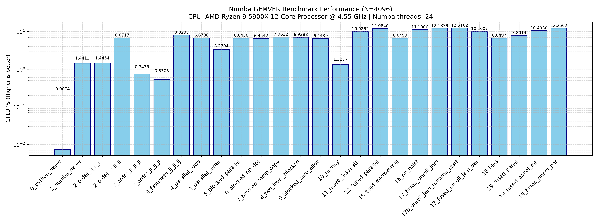
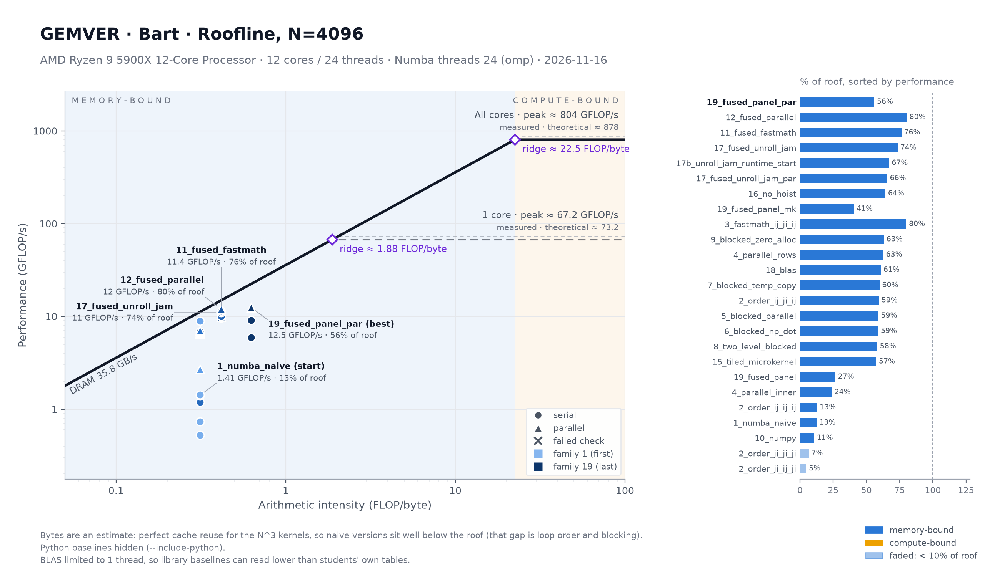
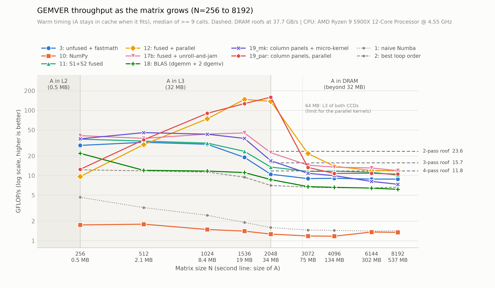

# GEMVER example

GEMVER ("vector multiplication and matrix addition") is a PolyBench linear-algebra kernel. In BLAS
terms it is two rank-1 updates (GER) followed by two matrix-vector products (GEMV). The BLAS
Technical Forum standard lists it as one fused "BLAS 2.5" routine, used for example when a matrix
is reduced to bidiagonal form on the way to its SVD. For an `N x N` matrix `A` and vectors
`u1, v1, u2, v2, w, x, y, z`, it runs four stages in order:

```
S1:  A = A + u1 v1^T + u2 v2^T      (update every element of A)
S2:  x = x + beta * A^T y           (matrix-vector product with A transposed)
S3:  x = x + z                      (vector add)
S4:  w = w + alpha * A x            (matrix-vector product)
```

The code is in `../../benchmarks/gemver_numba_bench.py`. Every version updates `A`, `x` and `w`
in place and is checked against a NumPy reference (`rtol = atol = 1e-5`).

## Code optimization

GEMVER is **memory-bound**. It does about 10 FLOPs per element of `A`, but the plain code moves
`A` through memory four times (S1 reads and writes it, S2 and S4 read it again): 32 bytes per
element, or 0.31 FLOP/byte. A core of the test machine can do about 73 GFLOP/s but stream only
about 37 GB/s, so it needs about 2 FLOP/byte to keep busy. For GEMVER at a size where `A` does not fit in
cache, a good first estimate is **time = passes over A x time per pass**. At `N = 4096`, `A` is
134 MB and one pass takes about 3.6 ms. The optimizations below either make each pass as fast as
memory allows (stride-1 access, SIMD) or remove passes (fusion).

| Stage | FLOPs | Bytes of A moved | FLOP/byte | Depends on |
| :--- | :--- | :--- | :--- | :--- |
| S1 | 4N² | 16N² (read + write) | 0.25 | nothing: every element is independent |
| S2 | 3N² | 8N² (read) | 0.375 | the new `A` from S1 |
| S3 | N | none (3 vectors) | - | all of S2 |
| S4 | 3N² | 8N² (read) | 0.375 | the **final** `x`, so all of S1-S3 |
| Total | 10N² + N | 32N² unfused | 0.31 | |

### 0- naive baseline

The direct translation of the PolyBench loops, run by the Python interpreter:

```python
def gemver_python_0(alpha, beta, A, u1, v1, u2, v2, w, x, y, z):
    n = A.shape[0]
    for i in range(n):                       # S1
        for j in range(n):
            A[i, j] = A[i, j] + u1[i] * v1[j] + u2[i] * v2[j]
    for i in range(n):                       # S2
        for j in range(n):
            x[i] = x[i] + beta * A[j, i] * y[j]
    for i in range(n):                       # S3
        x[i] = x[i] + z[i]
    for i in range(n):                       # S4
        for j in range(n):
            w[i] = w[i] + alpha * A[i, j] * x[j]
```

Every `A[i, j]` goes through the interpreter (index check, a new Python float, the add), so this
runs at 0.007 GFLOP/s: 22.6 s at `N = 4096`. It is the reference for the "Abs Speedup" column.

### 1- numba optimized

The same code with `@njit` on top. Numba compiles it to machine code with LLVM, which is about
200x faster (1.4 GFLOP/s at `N = 4096`).

Two problems remain. S2 reads `A[j, i]` with `j` in the inner loop, so it walks **down a column**
of the row-major matrix: each step jumps `8N` bytes and uses one double out of every 64-byte
cache line. And S2 and S4 are sums, which LLVM may not reorder without permission, so there is
no SIMD.

### 2- loop exchange

Each of the three double loops (S1, S2, S4) can run as `ij` (i outer) or `ji` (j outer). The
best order is `ij ji ij`:

```python
@njit
def gemver_2_ij_ji_ij(alpha, beta, A, u1, v1, u2, v2, w, x, y, z):
    _stage1_ij(A, u1, v1, u2, v2)        # A[i, j], j inner: along a row
    _stage2_ji(beta, A, x, y)            # A[j, i], i inner: along row j of A
    _stage3(x, z)
    _stage4_ij(alpha, A, w, x)           # A[i, j], j inner: along a row

@njit
def _stage2_ji(beta, A, x, y):
    n = A.shape[0]
    for j in range(n):
        for i in range(n):
            x[i] = x[i] + beta * A[j, i] * y[j]
```

`A` is stored row by row, so the inner loop must move along a row. S1 and S4 index `A[i, j]`, so
they need `j` inner. S2 indexes the transpose `A[j, i]`, so it needs the opposite order, `i`
inner. The new S2 inner loop, `x[i] += c * A[j, i]` with a fixed `c`, also has independent
iterations, so LLVM uses SIMD for it even without fastmath. This is 4.6x faster than Baseline 1
at `N = 4096`.

The `search` mode measures all 8 orders, with and without fastmath (`N = 4096`, GFLOP/s):

| S1 S2 S4 | fastmath off | fastmath on | Stages that read A along rows |
| :--- | :--- | :--- | :--- |
| ij ji ij | 6.26 | 7.79 | S1 S2 S4 |
| ij ji ji | 1.52 | 1.57 | S1 S2 |
| ij ij ij | 1.38 | 1.48 | S1 S4 |
| ji ji ij | 1.13 | 1.19 | S2 S4 |
| ij ij ji | 0.83 | 0.84 | S1 |
| ji ji ji | 0.74 | 0.75 | S2 |
| ji ij ij | 0.71 | 0.73 | S4 |
| ji ij ji | 0.53 | 0.53 | none |

Only the order where **all three** stages read along rows is fast. A single stage that walks
columns costs about 100 ms by itself at this size, so it sets the time whichever stage it is.
Changed alone, each choice is worth about 2-2.5x (S1 2.5x, S2 2.1x, S4 2.0x, geometric mean
over the other combinations).

### 3- compiler flags

```python
@njit(fastmath=True)
def gemver_opt_flags_3(alpha, beta, A, u1, v1, u2, v2, w, x, y, z):
    ...                                  # the ij ji ij loops of Baseline 2
```

S4 is a sum: `w[i] = w[i] + A[i,0]*x[0] + A[i,1]*x[1] + ...`. Floating-point addition is not
exactly associative, so without permission LLVM must add one term at a time. `fastmath=True`
lets it keep 4 partial sums in one AVX2 register and use fused multiply-add (FMA) instructions;
`python benchmarks/gemver_numba_bench.py 512 asm` shows the vector FMAs appear. The gain is 1.2x
at `N = 4096` and larger while `A` is in cache: at `N = 4096` the data still arrives at DRAM
speed, and Baseline 3 already moves about 26 GB/s.

### 4- parallelism

```python
@njit(parallel=True, fastmath=True)
def gemver_parallel_rows_4(alpha, beta, A, u1, v1, u2, v2, w, x, y, z):
    n = A.shape[0]
    for i in prange(n):                  # S1: each thread owns rows of A
        for j in range(n):
            A[i, j] = A[i, j] + u1[i] * v1[j] + u2[i] * v2[j]
    for i in prange(n):                  # S2: back to the strided order
        for j in range(n):
            x[i] = x[i] + beta * A[j, i] * y[j]
    ...
```

Parallelizing the rows is legal for S1 and S4, but S2 must go back to the strided column order:
with `j` outer, every thread would write all of `x` (a data race). A second version keeps the
fast S2 order and puts `prange` on the inner `i` loop, which starts a parallel region for every
row. Neither beats serial Baseline 3: one starts too many short parallel regions, and the other
reads A by columns. At `N = 4096` the bigger limit is memory bandwidth. The thread sweep
(`python benchmarks/gemver_numba_bench.py 4096 threads`) shows that more threads stop helping
after 2-4 threads, and on this machine 24 threads stream less than 2 (27.7 vs 37.5 GB/s).

### 5- loop tiling (5-9)

```python
for b in prange(num_blocks):             # 32-row blocks
    for j_block in range(0, n, bs):      # 32-column tiles
        for i in range(i_block, i_end):
            for j in range(j_block, j_end):
                A[i, j] = A[i, j] + u1[i] * v1[j] + u2[i] * v2[j]
```

Baselines 5-9 port matmul's blocking: 32x32 tiles (5), tiles with `np.dot`/`np.outer` (6),
temporary tile copies (7), two levels of tiles (8) and a version without any temporaries (9).
None of them beats Baseline 3; they all run at 6.4-7.1 GFLOP/s at `N = 4096`.

Tiling pays off when a tile in cache is used many times. In matmul each element of `A` is used
`N` times. In GEMVER each element is used **once per stage**, so a tile has nothing to keep.
The tiles also cut each row into 256-byte pieces, which the hardware prefetcher follows less
well than whole rows.

### 10- numpy

```python
def gemver_numpy_10(alpha, beta, A, u1, v1, u2, v2, w, x, y, z):
    A += np.outer(u1, v1) + np.outer(u2, v2)
    x += beta * np.dot(A.T, y)
    x += z
    w += alpha * np.dot(A, x)
```

The two `np.dot` calls are fast BLAS matrix-vector products, but S1 builds three full `N x N`
temporaries (two outer products and their sum). For a memory-bound kernel that extra traffic
costs more than the library saves: 1.3 GFLOP/s at `N = 4096`, slower than naive Numba.

### 11- loop fusion (stages 1+2)

```python
@njit(fastmath=True)
def gemver_fused_11(alpha, beta, A, u1, v1, u2, v2, w, x, y, z):
    n = A.shape[0]
    for i in range(n):
        a1 = u1[i]
        a2 = u2[i]
        c = beta * y[i]
        for j in range(n):
            a = A[i, j] + a1 * v1[j] + a2 * v2[j]   # S1
            A[i, j] = a
            x[j] += c * a                           # S2 uses the new value right away
    ...                                             # S3, then S4 as a row sum
```

S2 for row `i` only needs row `i` of the new `A`, and its additions into `x[j]` can happen in
any row order. So S1 and S2 can share one pass: each new `A[i, j]` is used while it is still in
a register. Seen from a row, S2 becomes `x[j] += beta*y[i]*A[i, j]`, the same transpose trick as
the `ji` order. This removes one pass over `A` (4 -> 3): 1.25x over Baseline 3 at `N = 4096`
(the ideal is 4/3 = 1.33x).

S4 cannot join this loop: row `i` of S4 needs the **final** `x`, and `x` is final only after
every row of `A` has gone through S2.

### 12- fusion + parallel

```python
for t in prange(num_chunks):             # each thread takes a chunk of rows
    for i in range(row_start, row_end):
        ...
        for j in range(n):
            a = A[i, j] + a1 * v1[j] + a2 * v2[j]
            A[i, j] = a
            partial[t, j] += c * a       # private copy of x per thread: no race
for j in prange(n):                      # add the private copies together
    ...
```

Every row adds into all of `x`, so each thread gets its own partial `x`, and the copies are
summed afterwards. At `N = 4096` this is 1.2x faster than serial 11 with 24 threads, and 1.26x
with 2 threads (thread sweep), where the memory system streams fastest.

### 15- tiling + micro-kernel

Baseline 9's tiles with a 4-row **micro-kernel** inside each tile: in S4, `x[j]` is loaded once
and used for 4 rows, with 4 independent sums in registers.

```python
for j in range(j_block, j_end):
    xj = x[j]                            # loaded once, used 4 times
    s0 += A[i, j] * xj
    s1 += A[i + 1, j] * xj
    s2 += A[i + 2, j] * xj
    s3 += A[i + 3, j] * xj
```

It runs at the same speed as Baseline 9 (6.65 GFLOP/s at `N = 4096`). The micro-kernel reuses the vector `x`, which
already sits in L1, but each element of `A` still crosses memory four times.

### 16- hoisting check

Baseline 11 hoists `u1[i]`, `u2[i]` and `beta*y[i]` out of the inner loop and reuses the new
`A[i, j]` through `a` (common-subexpression elimination). Baseline 16 undoes both on purpose:

```python
for i in range(n):
    for j in range(n):
        A[i, j] = A[i, j] + u1[i] * v1[j] + u2[i] * v2[j]
        x[j] += beta * y[i] * A[i, j]
```

The speed is the same as 11, within noise. LLVM's loop-invariant code motion and GVN passes do
the hoisting and the reuse by themselves, which `asm` mode confirms. Local rewrites like these
are the compiler's job; loop order and fusion are not.

### 17- micro-kernel on fused code (unroll-and-jam)

Baseline 11 with the **outer** loop unrolled by 4 and the copies merged ("jammed") into one
inner loop:

```python
while i + 4 <= row_end:
    ...                                  # u1, u2, beta*y for rows i .. i+3, hoisted
    for j in range(n):
        v1j = v1[j]                      # loaded once for 4 rows
        v2j = v2[j]
        r0 = A[i, j] + a10 * v1j + a20 * v2j
        r1 = A[i + 1, j] + a11 * v1j + a21 * v2j
        r2 = A[i + 2, j] + a12 * v1j + a22 * v2j
        r3 = A[i + 3, j] + a13 * v1j + a23 * v2j
        A[i, j] = r0
        ...
        xout[j] += c0 * r0 + c1 * r1 + c2 * r2 + c3 * r3   # x[j] once per 4 rows
    i += 4
```

LLVM already unrolls and vectorizes the inner loop, but it does not merge rows. Unroll-and-jam
loads `v1[j]`, `v2[j]` and `x[j]` once per 4 rows instead of once per row; S4 gets the same
4-row micro-kernel as Baseline 15. The DRAM traffic is still 3 passes.

**17b.** Baseline 17 calls these helpers with the constant start row `0`. To use SIMD, LLVM
adds a run-time check that the 4 rows do not overlap. With a known start row it hoists that
check out of the row loop and runs it once for all rows. Over all rows, "row i" and "row i+1"
cover almost the same memory, so the check fails and the scalar fallback runs every time.
Baseline 17b passes the start row as an argument, so the check stays per 4-row block and passes:

```python
@njit(fastmath=True)
def gemver_fused_unroll_jam_17b(alpha, beta, A, u1, v1, u2, v2, w, x, y, z, row_start):
    n = A.shape[0]
    _fused_rows_4(beta, A, u1, v1, u2, v2, y, x, row_start, n)   # called with row_start = 0
    ...
```

17b is the fastest serial version: 12.5 GFLOP/s at `N = 4096`, which is 80% of the 3-pass memory
limit, and up to 2.6x faster than 17 while `A` is in cache. More compile-time knowledge is not
always faster.

### 18- optimized baseline (BLAS)

The "`np.dot` of GEMVER": vendor BLAS for every stage, in place, with no temporaries. OpenBLAS
and MKL have no GEMVER routine, so it is built from `dgemm` and `dgemv`:

```python
At = A.T                                 # column-major view of A, no copy
blas.dgemm(1.0, V, U, beta=1.0, c=At, trans_b=1, overwrite_c=1)  # S1: A += [u1 u2][v1 v2]^T
blas.dgemv(beta, At, y, beta=1.0, y=x, overwrite_y=1)            # S2: x += beta A^T y
x += z                                                           # S3
blas.dgemv(alpha, At, x, beta=1.0, y=w, trans=1, overwrite_y=1)  # S4: w += alpha A x
```

Separate library calls cannot share a pass, so this is still 4 passes: 6.65 GFLOP/s at
`N = 4096`, below Baseline 3 and about half of 17b. With all BLAS threads (`blas_mt` mode) it is
no faster (6.3), because memory bandwidth is the limit, not compute. The bench prints which BLAS
is called: SciPy's OpenBLAS 0.3.31, one thread.

### 19- full fusion by column panels (+ micro-kernel)

S4 waits for the final `x`, but **column `j` of S4 only needs `x[j]`**, and `x[j]` is final as
soon as column `j` has been seen by every row. So walk `A` in column panels of width `PW`:

```python
for jb in range(0, n, pw):
    je = min(jb + pw, n)
    _panel_s12_rows4(beta, A, u1, v1, u2, v2, y, x[jb:je], jb, je, 0, n)  # S1+S2 on the panel
    for j in range(jb, je):
        x[j] = x[j] + z[j]                                              # S3: x[jb:je] final
    _panel_s4_rows4(alpha, A, x, w, jb, je, 0, n)                        # S4 on the same panel
```

If the panel (`N x PW x 8` bytes) stays in the L3 cache, the second pass over it does not touch
DRAM: `A` is read once and written once, **2 passes**. That is the minimum, because `A` is an
output. Three versions: one row at a time (19), the 4-row micro-kernel of 17 inside each panel
(19_mk), and threads splitting the rows of each panel (19_par). The default `PW` is the largest
power of two whose panel fits in half of the L3 (512 at `N = 4096`); `--pw` changes it.

On this machine panels do not beat 17b. 19_mk reaches 10.5 GFLOP/s at `N = 4096` and 19_par
12.3. Cutting rows into `PW`-long pieces makes the first pass slower (11.0 vs 9.3 ms in a
separate test), and the second pass is not fully served from L3. The search below shows that
wider panels are faster, and that one panel (`PW = N`, which is just 17 again) is as fast as
the best panel width.

### Fusion opportunities

The dependences decide what can share a pass over `A`:

1. **S1 -> S2: element by element.** S2 needs only the new `A[i, j]`, and its sum into `x[j]`
   can be done in any order. Fusing them is legal for whole rows (Baseline 11): 4 -> 3 passes.
2. **S2 -> S4: through the whole vector `x`.** Row `i` of S4 needs every `x[j]`, so whole rows
   cannot be fused. Column panels can, because a panel of S4 needs only that panel's `x[j]`
   (Baseline 19): 3 -> 2 passes, as long as the panel stays in cache.
3. **S3** only touches vectors; it moves into the panel loop for free.

The per-stage breakdown (`python benchmarks/gemver_numba_bench.py 4096 breakdown`) shows that
time follows the passes. S1 (2 passes) takes 48% of Baseline 3's time, S2 and S4 (1 pass each)
27% and 25%, and S3 0%. After fusion, S1+S2 in 17b costs 9.7 ms, about what S1 alone cost
(10.6 ms): S2's pass is gone.


### Summary

The overall progression is shown in . It can be
summarized as:

1. a correct but slow Python loop nest,
2. JIT compilation to remove interpreter overhead,
3. a loop order that reads `A` along rows in every stage (the biggest single gain),
4. fastmath, so the sums can use SIMD and FMA,
5. parallel loops and tiling, which do not help a kernel with no reuse and no spare bandwidth,
6. loop fusion of S1 and S2 (4 -> 3 passes over `A`),
7. unroll-and-jam on the fused loop, with the start row passed at run time (17b), and
8. column panels that fuse all four stages (2 passes in theory, not faster on this machine).

The table summary is (copied from benchmark output, `python benchmarks/gemver_numba_bench.py 4096 md`):

| Baseline Implementation | GFLOP/s | Time (ms) | Abs Speedup | Rel Speedup | Passes over A | GB/s | % of peak | Correct |
| :--- | :--- | :--- | :--- | :--- | :--- | :--- | :--- | :--- |
| 0_python_naive               |      0.007 |  22639.221 |       1.00x |       1.00x |             4 |     0.0 |        0% | PASS    |
| 1_numba_naive                |      1.441 |    116.417 |     194.47x |     194.47x |             4 |     4.6 |       12% | PASS    |
| 2_order_ij_ij_ij             |      1.445 |    116.077 |     195.04x |       1.00x |             4 |     4.6 |       12% | PASS    |
| 2_order_ij_ji_ij             |      6.672 |     25.147 |     900.26x |       4.62x |             4 |    21.3 |       57% | PASS    |
| 2_order_ji_ji_ji             |      0.743 |    225.713 |     100.30x |       0.11x |             4 |     2.4 |        6% | PASS    |
| 2_order_ji_ij_ji             |      0.530 |    316.387 |      71.56x |       0.71x |             4 |     1.7 |        5% | PASS    |
| 3_fastmath_ij_ji_ij          |      8.023 |     20.911 |    1082.66x |      15.13x |             4 |    25.7 |       68% | PASS    |
| 4_parallel_rows              |      6.674 |     25.139 |     900.54x |       0.83x |             4 |    21.4 |       57% | PASS    |
| 4_parallel_inner             |      3.330 |     50.378 |     449.39x |       0.50x |             4 |    10.7 |       28% | PASS    |
| 5_blocked_parallel           |      6.646 |     25.245 |     896.76x |       2.00x |             4 |    21.3 |       57% | PASS    |
| 6_blocked_np_dot             |      6.454 |     25.995 |     870.91x |       0.97x |             4 |    20.7 |       55% | PASS    |
| 7_blocked_temp_copy          |      7.061 |     23.760 |     952.82x |       1.09x |             4 |    22.6 |       60% | PASS    |
| 8_two_level_blocked          |      6.939 |     24.180 |     936.30x |       0.98x |             4 |    22.2 |       59% | PASS    |
| 9_blocked_zero_alloc         |      6.444 |     26.036 |     869.52x |       0.93x |             4 |    20.6 |       55% | PASS    |
| 10_numpy                     |      1.328 |    126.370 |     179.15x |       0.21x |             4 |     4.2 |       11% | PASS    |
| 11_fused_fastmath            |     10.029 |     16.729 |    1353.31x |       7.55x |             3 |    24.1 |       64% | PASS    |
| 12_fused_parallel            |     12.084 |     13.884 |    1630.57x |       1.20x |             3 |    29.0 |       77% | PASS    |
| 15_tiled_microkernel         |      6.650 |     25.230 |     897.31x |       0.55x |             4 |    21.3 |       57% | PASS    |
| 16_no_hoist                  |     11.181 |     15.006 |    1508.67x |       1.68x |             3 |    26.8 |       71% | PASS    |
| 17_fused_unroll_jam          |     12.184 |     13.770 |    1644.06x |       1.09x |             3 |    29.2 |       78% | PASS    |
| 17b_unroll_jam_runtime_start |     12.516 |     13.405 |    1688.90x |       1.03x |             3 |    30.0 |       80% | PASS    |
| 17_fused_unroll_jam_par      |     10.101 |     16.610 |    1362.96x |       0.81x |             3 |    24.2 |       65% | PASS    |
| 18_blas                      |      6.650 |     25.230 |     897.30x |       0.66x |             4 |    21.3 |       57% | PASS    |
| 19_fused_panel               |      7.801 |     21.506 |    1052.69x |       1.17x |             2 |    12.5 |       33% | PASS    |
| 19_fused_panel_mk            |     10.493 |     15.989 |    1415.90x |       1.35x |             2 |    16.8 |       45% | PASS    |
| 19_fused_panel_par           |     12.256 |     13.689 |    1653.82x |       1.17x |             2 |    19.6 |       52% | PASS    |

At `N = 512` (`A` = 2 MB, fits in the L3 cache), :

| Baseline Implementation | GFLOP/s | Time (ms) | Abs Speedup | Rel Speedup | Passes over A | GB/s | % of peak | Correct |
| :--- | :--- | :--- | :--- | :--- | :--- | :--- | :--- | :--- |
| 0_python_naive               |      0.007 |    352.742 |       1.00x |       1.00x |             4 |     0.0 |        0% | PASS    |
| 1_numba_naive                |      2.869 |      0.914 |     386.00x |     386.00x |             4 |     9.2 |       25% | PASS    |
| 2_order_ij_ij_ij             |      2.884 |      0.909 |     388.06x |       1.00x |             4 |     9.2 |       25% | PASS    |
| 2_order_ij_ji_ij             |      7.896 |      0.332 |    1062.32x |       2.74x |             4 |    25.3 |       69% | PASS    |
| 2_order_ji_ji_ji             |      0.951 |      2.757 |     127.92x |       0.12x |             4 |     3.0 |        8% | PASS    |
| 2_order_ji_ij_ji             |      0.790 |      3.320 |     106.24x |       0.83x |             4 |     2.5 |        7% | PASS    |
| 3_fastmath_ij_ji_ij          |     13.398 |      0.196 |    1802.46x |      16.96x |             4 |    42.9 |      117% | PASS    |
| 4_parallel_rows              |      9.239 |      0.284 |    1242.92x |       0.69x |             4 |    29.6 |       81% | PASS    |
| 4_parallel_inner             |      0.579 |      4.532 |      77.84x |       0.06x |             4 |     1.9 |        5% | PASS    |
| 5_blocked_parallel           |      8.511 |      0.308 |    1145.08x |      14.71x |             4 |    27.2 |       74% | PASS    |
| 6_blocked_np_dot             |      9.145 |      0.287 |    1230.35x |       1.07x |             4 |    29.3 |       80% | PASS    |
| 7_blocked_temp_copy          |      7.764 |      0.338 |    1044.54x |       0.85x |             4 |    24.8 |       68% | PASS    |
| 8_two_level_blocked          |      6.031 |      0.435 |     811.37x |       0.78x |             4 |    19.3 |       53% | PASS    |
| 9_blocked_zero_alloc         |      8.885 |      0.295 |    1195.33x |       1.47x |             4 |    28.4 |       78% | PASS    |
| 10_numpy                     |      1.624 |      1.615 |     218.43x |       0.18x |             4 |     5.2 |       14% | PASS    |
| 11_fused_fastmath            |     15.677 |      0.167 |    2109.07x |       9.66x |             3 |    37.6 |      103% | PASS    |
| 12_fused_parallel            |     15.275 |      0.172 |    2055.01x |       0.97x |             3 |    36.6 |      100% | PASS    |
| 15_tiled_microkernel         |      9.268 |      0.283 |    1246.88x |       0.61x |             4 |    29.6 |       81% | PASS    |
| 16_no_hoist                  |     15.302 |      0.171 |    2058.60x |       1.65x |             3 |    36.7 |      100% | PASS    |
| 17_fused_unroll_jam          |     13.449 |      0.195 |    1809.40x |       0.88x |             3 |    32.3 |       88% | PASS    |
| 17b_unroll_jam_runtime_start |     17.393 |      0.151 |    2339.91x |       1.29x |             3 |    41.7 |      114% | PASS    |
| 17_fused_unroll_jam_par      |     13.266 |      0.198 |    1784.68x |       0.76x |             3 |    31.8 |       87% | PASS    |
| 18_blas                      |      9.466 |      0.277 |    1273.44x |       0.71x |             4 |    30.3 |       83% | PASS    |
| 19_fused_panel               |     15.279 |      0.172 |    2055.60x |       1.61x |             2 |    24.4 |       67% | PASS    |
| 19_fused_panel_mk            |     17.916 |      0.146 |    2410.26x |       1.17x |             2 |    28.7 |       78% | PASS    |
| 19_fused_panel_par           |     11.918 |      0.220 |    1603.37x |       0.67x |             2 |    19.1 |       52% | PASS    |

Columns: "Passes over A" is the model count of full reads or writes of `A`. "GB/s" is that
count x the size of `A` / time, and "% of peak" compares it with the best measured stream
bandwidth (`a = a + s*b`, 37.5 GB/s). When `A` fits in cache, "% of peak" can pass 100%.

Note. numbers are obtained from an AMD Ryzen 9 5900X: 12 cores / 24 threads, AVX2 (4 doubles
per SIMD register), 32 KB L1d and 512 KB L2 per core, 32 MB L3 per 6-core CCD (64 MB in total),
measured stream bandwidth 37.5 GB/s. Numba 0.67 (LLVM 22), OpenBLAS limited to one thread.
Times are medians of at least 9 calls. Each call gets a fresh copy of `A`, so `A` starts
outside the cache, as in PolyBench (which flushes the cache before timing). At `N = 512` the
result of that copy depends on the state of the operating system's memory, and times can move
by up to 2x between runs. The scalability section uses repeated calls with `A` already in
cache, which gives steady numbers.

### Roofline

Below shows the roofline model for the above benchmark (`N = 4096`, made with
`python demos/run_roofline.py benchmarks/gemver_numba_bench.py --n 4096 --all`):



Every version sits far left of the ridge point (1.88 FLOP/byte for one core), so all of them are
memory-bound. The roof depends on the passes over `A`: 4 passes give 0.31 FLOP/byte, 3 passes
0.42 and 2 passes 0.625. With the 35.8 GB/s the roofline script measured, the roofs are 11.2,
15.0 and 22.4 GFLOP/s. Fusion raises the roof itself. In the table run (37.5 GB/s, 3-pass
roof 15.6), 17b reaches 80% of the 3-pass roof. The best number measured at this size,
14.9 GFLOP/s by Baseline 12 with 2 threads, is 96% of it. The 2-pass panels would allow about
23 GFLOP/s, but they stay at about half of that (see Baseline 19). The roofline run is a
separate run, so its percentages for the close fused versions differ from the table by a few
points.

### Scalability

`python benchmarks/gemver_numba_bench.py scale` runs the main versions from `N = 256` to `8192`.
Here `A` stays in cache between calls whenever it fits.



- While `A` fits in a core's 32 MB L3 (`N <= 1536`), 17b runs at 37-45 GFLOP/s and Baseline 3
  at about 30.
- At `N = 2048` (`A` = 33.6 MB) the serial versions slow down by about half. In DRAM they settle
  under the roofs: 17b at 12-14.5 GFLOP/s, Baseline 3 at about 9.
- The parallel versions (12, 19_par) reach 147-159 GFLOP/s while `A` fits in the 64 MB of both
  CCDs' L3, then fall to 11-14 in DRAM. Threads pay off in cache, hardly in DRAM.
- Fusion keeps its lead after the drop: 17b stays 1.35-1.6x ahead of Baseline 3 for every
  `N >= 3072`, and BLAS (18) stays at about 0.7x of Baseline 3.

## Search space

The choices behind these versions form a search space:

1. **Loop order:** `ij` or `ji` for S1, S2 and S4: 8 combinations.
2. **Backend flags:** fastmath on or off: 2.
3. **Parallel loop:** none, the rows, or the inner loop: 3.
4. **Threads:** 1, 2, 4, 6, 8, 12, 16, 24: 8.
5. **Tile / panel width:** 32 ... 2048 and `N`: 8.
6. **Unroll (rows per step):** 1, 2, 4, 8: 4.
7. **Fusion:** none, S1+S2, or all four stages: 3.

The total combinatorial search space is 8 x 2 x 3 x 8 x 8 x 4 x 3 = **36,864**. That is an upper
bound: many combinations are illegal (a parallel `ji` S2 races on `x`) or meaningless (24
threads with no parallel loop). `python benchmarks/gemver_numba_bench.py 4096 search` measures
114 of them (0.3%), one or two dimensions at a time with the others fixed at their best, like a
coordinate search: the 16 loop-order and fastmath kernels (table in section 2), Baseline 19's
panel width x rows per step, and 19_par's panel width x threads.


- Wider panels are faster for every row count; 1 row per step is the slowest and 2, 4 and 8
  rows are close. The best cell (13.3 GFLOP/s) is the single panel, which equals 17b.
- 19_par is best with 1-4 threads and wide panels (about 14 GFLOP/s); 12-24 threads give about
  10.5 for every panel width.
- Each configuration is checked against NumPy before it is timed.

`swiftpack` has no loop-fusion transformation yet, so this search runs over hand-written
kernels rather than over code that `swiftpack` generates.
